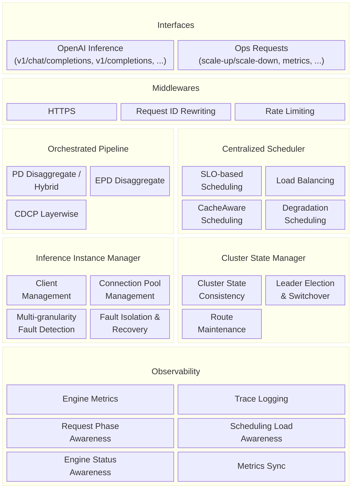

# RouteServer Architecture

[English](architecture.md) | [简体中文](architecture.zh-CN.md)

RouteServer is a distributed OpenAI inference orchestration frontend, designed for Large Language Model (LLM) service scenarios. It supports inference workflows across various vLLM deployment patterns. Aiming to provide distributed high-availability inference request execution workflows, it achieves efficient, scalable, and reliable inference load-balancing services through centralized request scheduling, inference engine fault awareness and isolation, and cluster state coordination.

- Supports two deployment modes:
  - **Standalone deployment**: Simple single-machine deployment, suitable for scenarios where inference instance addresses are fixed in advance.
  - **Distributed deployment**: Supports distributed request processing with horizontal scaling to prevent RouteServer from becoming an inference performance bottleneck. Through leader election, it provides centralized and unified inference request scheduling to avoid scheduling conflict performance issues caused by distributed routers scheduling independently.

- Supports multiple vLLM deployment modes:
  - [PD Hybrid](orchestrations/pd-hybrid.md): Prefill and Decode stages run in the same vLLM instance.
  - [PD Disaggregate](orchestrations/pd-disaggregate.md): Prefill and Decode stages disaggregated into separate vLLM instances for independent scaling.
  - [EPD Disaggregate](orchestrations/epd-disaggregate.md): Encode, Prefill, and Decode stages fully disaggregated into separate vLLM instances.
  - [Layerwise CDCP](orchestrations/layerwise-cdcp.md): vLLM PD disaggregated deployment where Prefill actively pushes prompt KV cache to Decode in a layerwise manner during prefilling. See [vllm-ascend issue](https://github.com/vllm-project/vllm-ascend/issues/4842).

- Supports multiple load balancing and scheduling algorithms designed for LLM inference. See [load-balancing](load-balancing.md).

- Multi-granularity fault detection, isolation, and automatic recovery: In both standalone and distributed systems, collects request processing information and perceives inference instance faults through mechanisms such as request error type identification, instance output token performance, and proactive probe requests, performing real-time isolation.

- Provides observable interfaces to retrieve various runtime states within the cluster.

## Architecture Overview

The architecture of RouteServer is organized into six layers, from top to bottom:

- **Interfaces Layer** — Entry points for external access, including OpenAI-compatible inference APIs and operational management APIs.
- **Middlewares Layer** — Common HTTP processing logic such as HTTPS termination, request ID rewriting, and rate limiting.
- **Orchestrated Pipeline Layer** — The core inference workflow engine, configurable via YAML to assemble DAG-based execution pipelines for different deployment patterns (PD Hybrid, PD Disaggregate, EPD Disaggregate, Layerwise CDCP/CPCD).
- **Centralized Scheduler Layer** — Inference request scheduling and load balancing, supporting multiple algorithms: SLO-based group scheduling, intra-group load balancing, CacheAware scheduling with prefix caching affinity, and degradation fallback scheduling.
- **Inference Instance Manager Layer** — Lifecycle management of inference engine (vLLM) instances, including client management, connection pooling, multi-granularity fault detection (active health probes, request failure analysis, hang detection, link-down detection), and automatic fault isolation and recovery.
- **Cluster State Manager Layer** — Cluster coordination in distributed deployments, providing cluster state consistency, leader election and switchover, and route discovery/maintenance, implemented on top of Etcd.
- **Observability Layer** — Cross-cutting monitoring and diagnostics, including Prometheus metrics, distributed trace logging, request phase awareness, scheduling load awareness, engine status awareness, and metrics synchronization from inference instances.

---

## 1. Interfaces Layer

RouteServer exposes two categories of external interfaces:

### OpenAI Inference APIs

RouteServer is compatible with the OpenAI API specification and provides the following core inference endpoints:

| Endpoint | Description |
|---|---|
| `POST /v1/chat/completions` | Chat completions — the primary endpoint for interactive LLM chat scenarios |
| `POST /v1/completions` | Text completions — for traditional text completion tasks |

These endpoints accept the same request/response format as OpenAI's API. RouteServer handles the request by routing it through the configured pipeline, scheduling appropriate inference instances, and returning responses in the OpenAI-compatible streaming or non-streaming format.

### Ops APIs

Operational management APIs for cluster administration, including but not limited to:

- Instance scale-up/scale-down operations
- Metrics query endpoints (Prometheus `/metrics`)
- Health check endpoints
- Runtime configuration inspection

---

## 2. Middlewares Layer

The middleware layer intercepts incoming HTTP requests before they reach the pipeline handler, providing cross-cutting processing logic.

### HTTPS

HTTPS termination is supported for secure communication. When configured, all incoming HTTP requests are decrypted at this layer before being processed internally.

### Request ID Rewriting

Each inference request is assigned a unique request ID suffix for tracing and correlation purposes. The request ID can originate from:
- The `X-Request-Id` header in the incoming request
- The `request-id` field in the JSON request body (for OpenAI-compatible clients that pass it)
- Auto-generation if neither is present

The request ID is propagated through all pipeline phases, trace logs, and metrics, enabling end-to-end request tracking across the entire system. See `pkg/route-server/handler/request/utils.go:112` for the three supported rewrite strategies.

### Rate Limiting

- For non openai infer request, a QPM rate limiter is applied per API path. It supports:
  - Configurable requests-per-minute per path
  - Exempt paths that bypass rate limiting (e.g., health checks)
  - Response headers: `X-RateLimit-Limit`, `X-RateLimit-Remaining`
- For openai infer request(POST /v1/chat/completions, POST /v1/completions), a max concurrency config is provided, see `max-concurrent-requests` in [config spec doc](../docs/config-spec.md)

See `pkg/route-server/middleware/rate_limiter.go`.

Additionally, a **request body size limiter** (`pkg/route-server/middleware/body_limit.go`) restricts the maximum content length to prevent oversized requests, returning HTTP 413 when exceeded.

---

## 3. Orchestrated Pipeline Layer

This is the core inference workflow engine of RouteServer. It provides a **configuration-driven, DAG-based execution framework** that assembles inference workflows by declaring Phases and their dependencies in YAML configuration files.

See [About Infer Pipeline](orchestrations/about-infer-pipeline.md) for a detailed explanation of the pipeline framework.

---

## 4. Centralized Scheduler Layer

The scheduler layer is responsible for selecting the most appropriate inference instance for each request. It supports multiple scheduling algorithms that can be configured per instance role (prefill, decode, encode) and per SLO group.

### Scheduling Framework

The scheduling framework (`pkg/route-server/scheduler/manager.go`) is organized as follows:

- **SchedulersManager**: The central manager that maintains a map of `(role, sloTag) → Algorithm` instances. When `DispatchRequest()` is called, it selects the appropriate algorithm based on the request's instance role and SLO tag.
- **Fallback Mechanism**: If the primary scheduling algorithm fails (e.g., all instances are unhealthy), the `doFallbackDispatch()` method falls back to a simpler algorithm (RoundRobin) to ensure requests are still processed.
- **Remote Scheduling**: In distributed mode, non-leader nodes forward scheduling requests to the leader via `RemoteScheduler`, ensuring centralized decision-making and avoiding scheduling conflicts.

See [load balancing doc](load-balancing.md) for further details

## 5. Inference Instance Manager Layer

The instance manager (`pkg/route-server/instances/instances_manager.go`) handles the full lifecycle of inference engine (vLLM) instances, from registration to fault recovery.

### Client Management

Each inference instance is represented by an `Instance` struct (`pkg/common/client/instance.go`) containing:
- Instance ID, IP address, and port
- Role (prefill, decode, encode)
- `InstanceClient` — an HTTP client for communicating with the vLLM instance
- Health check counters (consecutive successes, failures, unreachable counts)
- Fault information (fault message, fault type)

The instance client (`pkg/common/client/instance-client/`) provides methods for:
- `Generate()` — Sending inference requests to the vLLM instance
- `HealthCheck()` — Probing the instance's health endpoint
- `ProxyHttp()` — Proxying HTTP requests to the instance

### Connection Pool Management

The instance manager maintains connection pools to each inference instance for efficient HTTP communication. Pool settings include connection timeouts, idle connection management, and keep-alive configurations to minimize connection establishment overhead.

### Multi-granularity Fault Detection & Recovery

Fault detection operates at multiple levels of granularity, including active health probes, request failure analysis, hang detection, and KV transfer link monitoring. The health check system is orchestrated by `LeaderHealthChecker`, which aggregates events from all sub-modules and drives instance state transitions between healthy and unhealthy.

Fault isolation and recovery mechanisms include a circuit breaker with force-mode support, instance state management (available/unavailable maps), failure persistence via Etcd, and probe inference requests before recovery.

Worker-side event collection (`WorkerEventCollector`) batches and asynchronously reports request events and token events to the leader for centralized fault analysis.

See [Inference Instance Health](infer-instance-health.md) for a detailed explanation.

---

## 6. Cluster State Manager Layer

The cluster manager provides distributed coordination for multi-node RouteServer deployments. It is built on top of Etcd and supports two modes: standalone (singleton) and distributed (Etcd-based).

### Cluster Service Interface

Defined in `pkg/common/cluster/types.go`, the `ClusterService` interface provides:

- `IsLeader()` / `GetLeader()` / `LocalNode()` — Leader election and node identity
- `HandleNewPeer()` / `HandleLeavePeer()` — Peer join/leave events
- `HandleNewInstance()` / `HandleLeaveInstance()` — Inference instance registration/deregistration
- `PersistInstanceFailures()` — Durable failure storage
- `RegisterStateApplier()` — Register callbacks for state changes
- `GetHealthStats()` — Cluster health statistics

### Implementations

| Implementation | File | Description |
|---|---|---|
| **EtcdClusterService** | `pkg/route-server/cluster/etcd/cluster_service.go` | Full distributed cluster service using Etcd. Provides leader election via Etcd leases, state consistency via atomic operations, and service discovery via watch-based route maintenance. |
| **SingletonClusterService** | `pkg/route-server/cluster/singleton/singleton.go` | Simplified standalone mode with no external dependencies. All peers, instances, and state are managed locally in memory. |

### Cluster State Consistency

The cluster state (`ClusterState` in `types.go`) includes:
- **Peers**: All active RouteServer nodes in the cluster
- **InstanceRoutes**: Mapping of inference instances to their hosting nodes
- **Version**: State version for consistency checking

State changes are propagated through Etcd watches, and `StateApplier` callbacks notify registered components (such as `InstanceManager`) of changes.

### Leader Election and Switchover

Leader election is implemented using Etcd leases:
- Nodes attempt to acquire a leader lease on startup.
- The node holding the lease is the leader and is responsible for centralized scheduling decisions.
- If the leader node fails, the lease expires and another node takes over.
- On switchover, the new leader restores cluster state and resumes scheduling.

Leader-based scheduling ensures that inference requests are scheduled consistently, avoiding conflicts that can arise when multiple nodes independently select instances for the same request.

### Route Maintenance

Instance routes are dynamically maintained:
- When a new inference instance registers, its route is added to the cluster state and propagated to all nodes.
- When an instance is removed (due to failure or scale-down), its route is deleted and all nodes are notified.
- The `InstanceManager` implements the `StateApplier` interface to react to route changes.

---

## 7. Observability Layer

Observability is a cross-cutting concern that spans all layers of the system with three pillars: Prometheus metrics, distributed trace logging, and runtime state awareness (request phase, scheduling load, engine status). Metrics are defined in `pkg/route-server/metrics/metrics.go` and exposed via the `/metrics` endpoint. Tracing is implemented via the `RequestTracer` interface (`pkg/common/trace/trace_interface.go`), supporting Log-based, OpenTelemetry, and composed backends.

See [Observability](observability.md) for a detailed explanation.