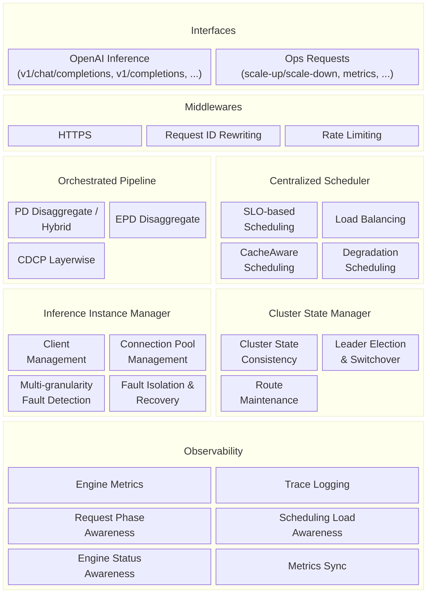

# RouteServer 架构

[English](architecture.md) | [简体中文](architecture.zh-CN.md)

RouteServer 是一个分布式 OpenAI 推理编排前端，面向大语言模型（LLM）服务场景。它支持多种 vLLM 部署模式下的推理工作流。以提供分布式高可用的推理请求执行工作流为目标，它通过集中式请求调度、推理引擎故障感知与隔离、集群状态协调，实现高效、可扩展且可靠的推理负载均衡服务。

- 支持两种部署模式：
  - **单机部署**：简单的单机部署，适用于推理实例地址预先固定的场景。
  - **分布式部署**：支持分布式请求处理，可水平扩展以避免 RouteServer 成为推理性能瓶颈。通过 leader 选举提供集中统一的推理请求调度，避免分布式路由节点各自独立调度所导致的调度冲突性能问题。

- 支持多种 vLLM 部署模式：
  - [PD Hybrid](orchestrations/pd-hybrid.zh-CN.md)：Prefill 与 Decode 阶段运行在同一个 vLLM 实例中。
  - [PD Disaggregate](orchestrations/pd-disaggregate.zh-CN.md)：Prefill 与 Decode 阶段分离到独立的 vLLM 实例，可独立扩缩容。
  - [EPD Disaggregate](orchestrations/epd-disaggregate.zh-CN.md)：Encode、Prefill、Decode 三个阶段完全分离到独立的 vLLM 实例。
  - [Layerwise CDCP](orchestrations/layerwise-cdcp.zh-CN.md)：vLLM PD 分离部署，其中 Prefill 在预填充过程中以逐层（layerwise）方式主动将 prompt KV cache 推送给 Decode。参见 [vllm-ascend issue](https://github.com/vllm-project/vllm-ascend/issues/4842)。

- 支持多种面向 LLM 推理的负载均衡与调度算法。参见 [load-balancing](load-balancing.zh-CN.md)。

- 多粒度故障检测、隔离与自动恢复：在单机与分布式系统中，均通过请求错误类型识别、实例输出 token 表现、主动探针请求等机制收集请求处理信息并感知推理实例故障，实时执行隔离。

- 提供可观测接口，用于获取集群内的各种运行时状态。

## 架构总览

RouteServer 的架构自上而下分为六层：

- **接口层** —— 外部访问的入口，包括 OpenAI 兼容的推理 API 与运维管理 API。
- **中间件层** —— 通用 HTTP 处理逻辑，例如 HTTPS 终止、请求 ID 重写与限流。
- **编排流水线层** —— 核心推理工作流引擎，可通过 YAML 配置组装基于 DAG 的执行流水线，以适配不同的部署模式（PD Hybrid、PD Disaggregate、EPD Disaggregate、Layerwise CDCP/CPCD）。
- **集中式调度器层** —— 推理请求调度与负载均衡，支持多种算法：基于 SLO 的分组调度、组内负载均衡、带前缀缓存亲和性的 CacheAware 调度，以及降级回退调度。
- **推理实例管理层** —— 推理引擎（vLLM）实例的生命周期管理，包括客户端管理、连接池、多粒度故障检测（主动健康探针、请求失败分析、卡死检测、链路中断检测），以及自动故障隔离与恢复。
- **集群状态管理层** —— 分布式部署中的集群协调，提供集群状态一致性、leader 选举与切换、路由发现与维护，基于 Etcd 实现。
- **可观测层** —— 横切的监控与诊断，包括 Prometheus 指标、分布式 trace 日志、请求阶段感知、调度负载感知、引擎状态感知，以及来自推理实例的指标同步。

---

## 1. 接口层

RouteServer 对外暴露两类接口：

### OpenAI 推理 API

RouteServer 兼容 OpenAI API 规范，提供以下核心推理端点：

| 端点 | 说明 |
|---|---|
| `POST /v1/chat/completions` | 对话补全 —— 交互式 LLM 对话场景的主要端点 |
| `POST /v1/completions` | 文本补全 —— 用于传统文本补全任务 |

这些端点接受与 OpenAI API 相同的请求/响应格式。RouteServer 处理请求的方式是：让请求流经配置好的流水线，调度合适的推理实例，并以 OpenAI 兼容的流式或非流式格式返回响应。

### 运维 API

用于集群管理的运维管理 API，包括但不限于：

- 实例扩容/缩容操作
- 指标查询端点（Prometheus `/metrics`）
- 健康检查端点
- 运行时配置查询

---

## 2. 中间件层

中间件层在 HTTP 请求到达流水线处理器之前进行拦截，提供横切处理逻辑。

### HTTPS

支持 HTTPS 终止以保障安全通信。配置后，所有入站 HTTP 请求在该层解密，再在内部处理。

### 请求 ID 重写

每个推理请求都会被分配唯一的请求 ID 后缀，用于追踪与关联。请求 ID 可以来自：

- 入站请求中的 `X-Request-Id` 头
- JSON 请求体中的 `request-id` 字段（适用于会传入该字段的 OpenAI 兼容客户端）
- 若二者均不存在则自动生成

请求 ID 会贯穿所有流水线阶段、trace 日志与指标，从而支持跨整个系统的端到端请求追踪。三种受支持的重写策略见 `pkg/route-server/handler/request/utils.go:112`。

### 限流

- 对于非 OpenAI 推理请求，按 API 路径应用 QPM 限流器。它支持：
  - 可配置的每路径每分钟请求数
  - 可豁免限流的路径（例如健康检查）
  - 响应头：`X-RateLimit-Limit`、`X-RateLimit-Remaining`
- 对于 OpenAI 推理请求（`POST /v1/chat/completions`、`POST /v1/completions`），提供最大并发配置，参见[配置规范文档](../docs/config-spec.zh-CN.md)中的 `max-concurrent-requests`

参见 `pkg/route-server/middleware/rate_limiter.go`。

此外，**请求体大小限制器**（`pkg/route-server/middleware/body_limit.go`）会限制最大内容长度以防止超大请求，超出时返回 HTTP 413。

---

## 3. 编排流水线层

这是 RouteServer 的核心推理工作流引擎。它提供**配置驱动、基于 DAG 的执行框架**，通过在 YAML 配置文件中声明 Phase 及其依赖关系来组装推理工作流。

关于流水线框架的详细说明，参见 [About Infer Pipeline](orchestrations/about-infer-pipeline.zh-CN.md)。

---

## 4. 集中式调度器层

调度器层负责为每个请求选择最合适的推理实例。它支持多种调度算法，可按实例角色（prefill、decode、encode）以及按 SLO 分组进行配置。

### 调度框架

调度框架（`pkg/route-server/scheduler/manager.go`）的组织方式如下：

- **SchedulersManager**：中心管理器，维护 `(role, sloTag) → Algorithm` 实例的映射。调用 `DispatchRequest()` 时，它根据请求的实例角色与 SLO 标签选择相应的算法。
- **回退机制**：如果主调度算法失败（例如所有实例均不健康），`doFallbackDispatch()` 方法会回退到更简单的算法（RoundRobin），以确保请求仍能被处理。
- **远程调度**：在分布式模式下，非 leader 节点通过 `RemoteScheduler` 将调度请求转发给 leader，从而保证集中决策并避免调度冲突。

更多细节参见[负载均衡文档](load-balancing.zh-CN.md)

## 5. 推理实例管理层

实例管理器（`pkg/route-server/instances/instances_manager.go`）负责推理引擎（vLLM）实例的完整生命周期，从注册到故障恢复。

### 客户端管理

每个推理实例由一个 `Instance` 结构体表示（`pkg/common/client/instance.go`），其中包含：

- 实例 ID、IP 地址与端口
- 角色（prefill、decode、encode）
- `InstanceClient` —— 用于与 vLLM 实例通信的 HTTP 客户端
- 健康检查计数器（连续成功、失败、不可达次数）
- 故障信息（故障消息、故障类型）

实例客户端（`pkg/common/client/instance-client/`）提供以下方法：

- `Generate()` —— 向 vLLM 实例发送推理请求
- `HealthCheck()` —— 探测实例的健康端点
- `ProxyHttp()` —— 将 HTTP 请求代理到实例

### 连接池管理

实例管理器为每个推理实例维护连接池，以实现高效的 HTTP 通信。连接池设置包括连接超时、空闲连接管理与 keep-alive 配置，以尽量减少建立连接的开销。

### 多粒度故障检测与恢复

故障检测在多个粒度上运行，包括主动健康探针、请求失败分析、卡死检测与 KV 传输链路监控。健康检查系统由 `LeaderHealthChecker` 编排，它聚合来自所有子模块的事件，并驱动实例在健康与不健康状态之间转换。

故障隔离与恢复机制包括支持强制模式的熔断、实例状态管理（可用/不可用映射）、通过 Etcd 持久化故障，以及恢复前的探针推理请求。

worker 侧的事件收集（`WorkerEventCollector`）会批量、异步地将请求事件与 token 事件上报给 leader，以进行集中式故障分析。

详细说明参见 [Inference Instance Health](infer-instance-health.zh-CN.md)。

---

## 6. 集群状态管理层

集群管理器为多节点 RouteServer 部署提供分布式协调。它构建在 Etcd 之上，支持两种模式：单机（单例）与分布式（基于 Etcd）。

### 集群服务接口

`ClusterService` 接口定义在 `pkg/common/cluster/types.go`，提供：

- `IsLeader()` / `GetLeader()` / `LocalNode()` —— leader 选举与节点身份
- `HandleNewPeer()` / `HandleLeavePeer()` —— peer 加入/离开事件
- `HandleNewInstance()` / `HandleLeaveInstance()` —— 推理实例注册/注销
- `PersistInstanceFailures()` —— 故障持久化存储
- `RegisterStateApplier()` —— 注册状态变更回调
- `GetHealthStats()` —— 集群健康统计

### 实现

| 实现 | 文件 | 说明 |
|---|---|---|
| **EtcdClusterService** | `pkg/route-server/cluster/etcd/cluster_service.go` | 使用 Etcd 的完整分布式集群服务。通过 Etcd lease 提供 leader 选举，通过原子操作保证状态一致性，并通过基于 watch 的路由维护实现服务发现。 |
| **SingletonClusterService** | `pkg/route-server/cluster/singleton/singleton.go` | 无外部依赖的简化单机模式。所有 peer、实例与状态均在本地内存中管理。 |

### 集群状态一致性

集群状态（`types.go` 中的 `ClusterState`）包括：

- **Peers**：集群中所有活跃的 RouteServer 节点
- **InstanceRoutes**：推理实例到其宿主节点的映射
- **Version**：用于一致性检查的状态版本

状态变更通过 Etcd watch 传播，`StateApplier` 回调会通知已注册的组件（例如 `InstanceManager`）发生了变更。

### Leader 选举与切换

leader 选举使用 Etcd lease 实现：

- 节点在启动时尝试获取 leader lease。
- 持有 lease 的节点即为 leader，负责集中式调度决策。
- 如果 leader 节点故障，lease 过期，另一个节点接管。
- 切换时，新 leader 恢复集群状态并继续调度。

基于 leader 的调度确保推理请求被一致地调度，避免多个节点为同一请求各自独立选择实例时可能产生的冲突。

### 路由维护

实例路由是动态维护的：

- 新推理实例注册时，其路由被加入集群状态并传播到所有节点。
- 实例被移除时（因故障或缩容），其路由被删除并通知所有节点。
- `InstanceManager` 实现 `StateApplier` 接口，以响应路由变更。

---

## 7. 可观测层

可观测性是一项横切关注点，贯穿系统所有层，包含三大支柱：Prometheus 指标、分布式 trace 日志，以及运行时状态感知（请求阶段、调度负载、引擎状态）。指标定义在 `pkg/route-server/metrics/metrics.go`，通过 `/metrics` 端点暴露。追踪通过 `RequestTracer` 接口（`pkg/common/trace/trace_interface.go`）实现，支持基于日志、OpenTelemetry 以及组合后端。

详细说明参见 [Observability](observability.zh-CN.md)。
