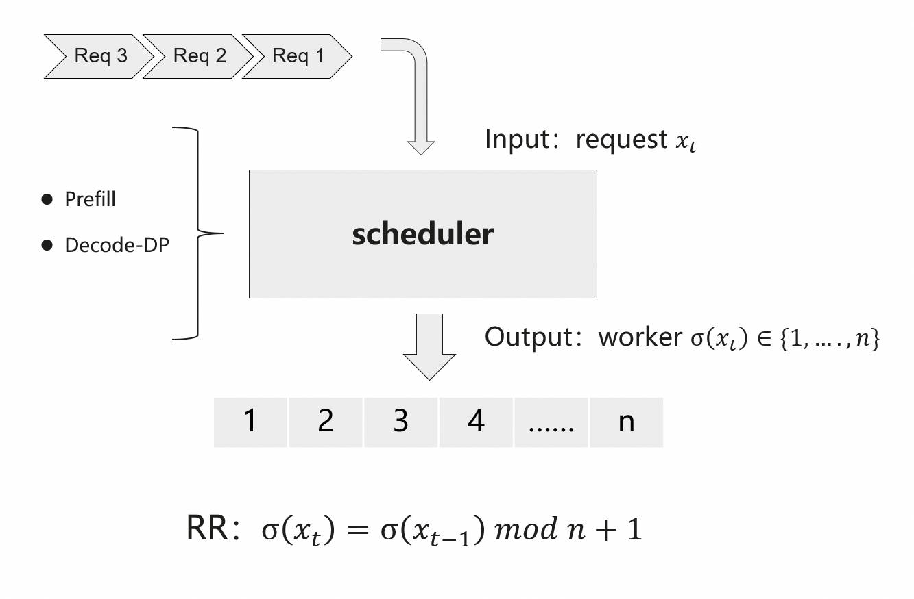
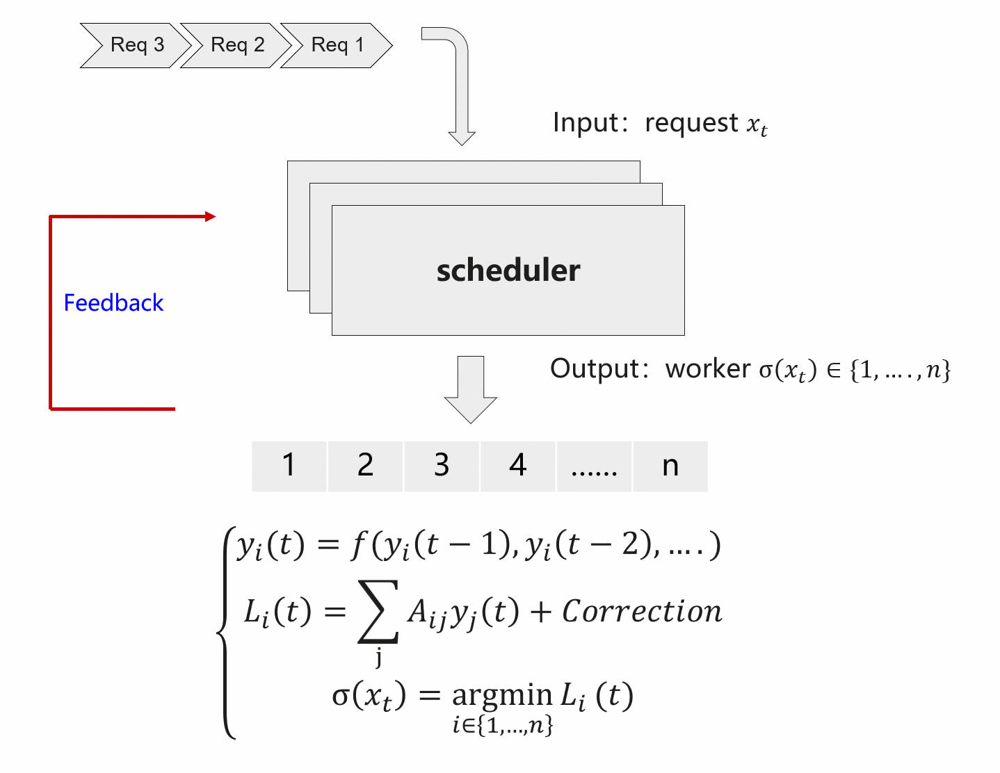
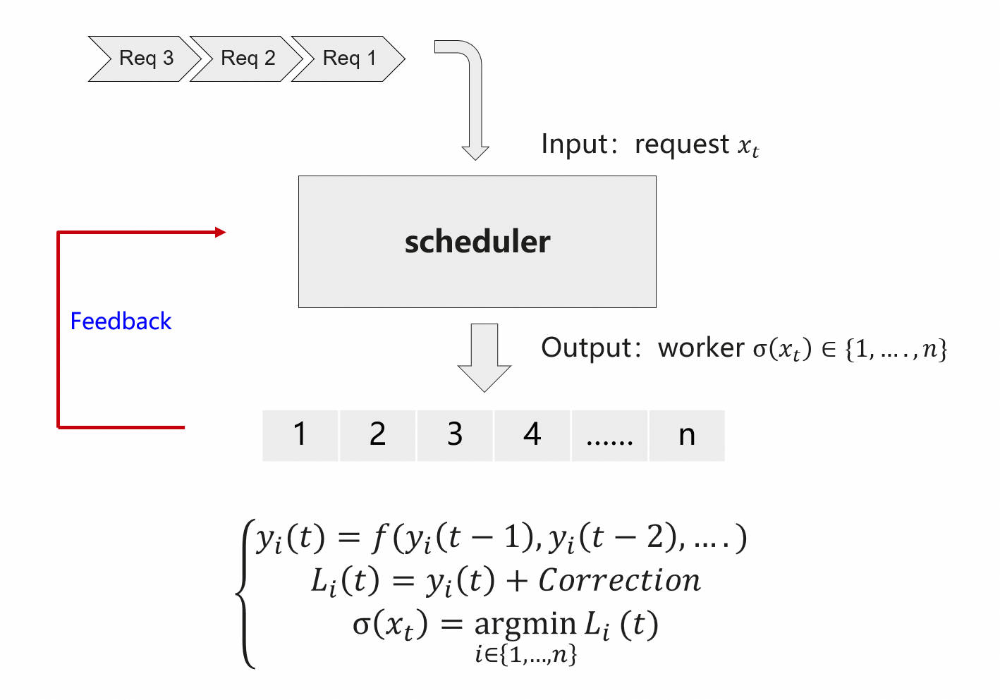

# 调度算法

## 概述

推理服务中，调度器负责将到来的请求分发到合适的工作实例。在 PD 分离架构下，Prefill 和 Decode 两个阶段各自需要将请求调度到对应的实例执行。

本系统支持以下四种调度算法：

| 算法名称 | 适用场景 | 核心策略 |
|---|---|---|
| round-robin | 简单场景，Prefill 侧和 Decode 侧均可 | 轮询分发 |
| least-total-load | Prefill 侧负载均衡 | 基于负载公式的最小负载优先 |
| apc | Prefill 侧带 KV Cache 复用的场景 | 前缀缓存感知 + 负载预测 |
| abc6 | Decode 侧负载均衡 | 状态感知 + 记忆修正 + 过载惩罚 |

---

## round-robin

### 1. 原理

最基础的调度算法，按轮询顺序将请求依次分发到各实例。鲁棒性较高，适用场景广泛，但不感知实例负载状态，仅保证请求在实例间均匀分配。当请求序列长短差异大时，无法保证各实例的真实负载均衡，可能产生快慢卡效应。


<center>Round-Robin 调度算法示意图</center>

该算法无状态感知、无负载建模，实现简单、开销极低，可作为其他算法的 fallback 算法使用。

### 2. 调度逻辑

1. 维护一个实例列表和当前索引 `currIndex`。
2. 每次请求到来时，`currIndex` 递增取模实例数量，选择对应实例。
3. 如果目标实例在黑名单中，跳过并尝试下一个。
4. 不需要任何指标采集（`NeedStatsList` 为空），不需要定时更新。

### 3. 配置参数

无需额外配置参数。

---

## least-total-load

### 1. 原理

基于请求 Token 长度与 BatchSize 约束，通过负载公式计算各实例的负载值，将请求分发到负载最低的实例。适用于 Prefill 侧——单条请求在一步内执行完毕，负载可由当前下发的 Token 长度之和度量。

**负载建模：** 每条请求的负载近似为其 Prompt Token 长度：

$$l_q \approx \text{length}(q)$$

实例负载计算公式引入 BatchSize 惩罚项：

$$\text{Load} = \text{total\_len} \times \frac{\lceil \text{req\_num} / \text{batchsize} \rceil + 1}{2}$$

- 当 `req_num < batchsize` 时，负载等于 Token 长度之和。
- 当 `req_num >= batchsize` 时，负载等于 Token 长度之和乘以 1.5 倍（假设 `req_num` 刚好超过 `batchsize`），起到软惩罚作用，避免向 BatchSize 已满的实例继续发送请求。每轮计算以当时请求数为准，决定是否乘上惩罚系数。

**记忆修正：** 调度器在分发请求后立即累加预估负载（请求个数 +1、Token 长度加上当前请求长度），请求完成时再减去。即使指标反馈存在延迟，调度决策仍基于最新的负载估计，避免短时间内将大量请求集中到同一实例。


<center>least-total-load 调度算法示意图</center>

### 2. 调度逻辑

1. 请求到来时，按负载公式计算各实例负载并升序排序，不计入当前新增请求。
2. 选择负载最低的实例分发请求；若存在黑名单实例则跳过。
3. 分发后立即更新该实例的请求计数和 Token 长度累计（记忆修正）。
4. 请求完成时，从对应实例减去该请求的负载，及时更新负载估计。

### 3. 配置参数

| 参数 | 说明 | 默认值 |
|---|---|---|
| max_num_seqs | 实例最大 BatchSize | 16 |
| verbose | 是否打印详细负载日志 | false |

---

## apc

### 1. 原理

APC（Aware Prefix Cache）算法在 least-total-load 的基础上增加了前缀缓存感知能力。当请求的 Prompt 与某实例已有的 KV Cache 存在前缀匹配时，将请求调度到该实例可复用已有缓存，减少重复计算。适用于 Prefill 侧存在多轮对话等可 KV Cache 复用的场景。

**架构：** APC 由两层组成：

1. **APCScheduler**：调度器层，负责负载计算、实例选择和负载增减管理。
2. **APCManager**：全局管理器，负责缓存查找、匹配、更新和持久化，支持多调度器通过共享内存协同。

**缓存匹配策略：** 当前支持 RollingHash 策略——将 Prompt 按固定大小分块（`block-size-bytes`），计算每块的滚动哈希值，通过哈希值在缓存中查找与当前 Prompt 前缀匹配的实例，返回匹配比例（`matched_ratio`）。支持 Progressive Block 策略，以更大粒度块先做粗筛，再细粒度匹配。

**负载建模：** 在 least-total-load 公式基础上，将请求的 Prompt Token 长度按匹配比例折减：

$$\text{reqLen} = \text{prompt\_tokens} \times (1 - \text{matched\_ratio}) + \text{prefix\_load\_base}$$

$$\text{Load} = \text{total\_len} \times \frac{\lceil \text{req\_num} / \text{batchsize} \rceil + 1}{2}$$

匹配比例越高，该请求对实例的负载贡献越小，从而引导调度器优先选择有缓存复用优势的实例。

### 2. 调度逻辑

1. 从 APCManager 获取各实例的缓存匹配比例（`matchedInstances`）。
2. 对每个可用实例，预计算加入该请求后的预测负载。
3. 选择预测负载最低的实例；若负载相同，选择匹配比例最高的实例。
4. 分发后更新实例负载和请求分发记录。

**缓存更新：** 仅当请求在 Prefill 阶段执行成功（`RequestPrefillSuccess` 事件）后才更新 APC 缓存，确保 KV Cache 确实已存在。缓存更新操作仅由集群 Leader 节点执行。

**降级机制：** 当 APC 未启用或不可用时（如 Manager 未初始化、非 Leader 节点），`DispatchRequest` 返回错误，调度器自动降级到 fallback 算法（round-robin）。

### 3. 配置参数

**调度器参数：**

| 参数 | 说明 | 默认值 |
|---|---|---|
| default-batch-size | 默认 BatchSize | 16 |
| prefix-load-base | 最小前缀负载基数 | 1 |

**Manager 参数：**

| 参数 | 说明 | 默认值 |
|---|---|---|
| enable | 是否启用 APC | false |
| strategies.hash.block-size-bytes | 分块大小（字节） | 64 |
| strategies.hash.max-blocks | 最大分块数 | 128 |
| strategies.hash.max-entries | 缓存最大条目数 | 100000 |
| strategies.hash.max-memory-mb | 缓存最大内存（MB） | 512 |
| strategies.hash.cache-ttl-sec | 缓存 TTL（秒） | 3600 |
| strategies.hash.progressive-base-block-size-bytes | 渐进分块基础大小 | 256 |
| persistence.enable | 是否启用持久化 | false |
| persistence.provider | 持久化提供者 | - |

---

## abc6

### 1. 原理

针对 Decode 侧的负载均衡算法，融合状态感知、记忆修正和过载惩罚三项关键机制。Decode 阶段请求持续多步执行，负载无法仅用请求个数表征，需要结合 Token 长度、等待队列和运行队列状态进行综合决策。

**状态感知：** 从推理引擎获取以下指标并回传到调度器：

| 指标 | 说明 |
|---|---|
| PromptTokensTotal + GenerationTokensTotal | 当前 Token 长度之和 |
| NumRequestsWaiting | 当前等待队列请求数 |
| NumRequestsRunning | 当前运行队列请求数 |

**记忆修正：** 从请求分发到实际执行、再到负载指标反馈存在时延，仅依赖反馈指标会导致短时间内请求集中到"看起来负载最低"的实例。abc6 的记忆修正机制如下：

- 分发请求时，立即将预估负载累加到目标实例，根据当前系统状态，分为两种更新方式：
  - 当排序类型为 TokenLoads（部分过载/全部不过载）时：`TokenLoads += reqLen`，`RunningQueue += 1`
  - 当排序类型为 WaitingQueue（全部过载）时：`WaitingQueue += 1`，TokenLoads 和 RunningQueue 不变
- 当采集数据更新后，更新负载估计数据为最新的采集数据。

**过载判定与惩罚：** 当某个实例出现排队或快要排队情况，则认为该实例过载/即将过载，需要减少发送请求。根据实际经验，实例过载往往发生过快，所以需要提前预判。判定实例过载的条件：

```
WaitingQueue >= 2  或  RunningQueue >= batchsize - 1
```

过载实例在排序时施加惩罚值，使其排序靠后。


<center>abc6 调度算法示意图</center>

### 2. 调度逻辑

1. 检查所有实例是否过载：
   - **全部过载**：按等待请求数（`WaitingQueue`）排序，选择等待请求最少的实例，退化为基于请求个数的均衡策略。
   - **部分过载**：按 Token 长度负载排序，对过载实例施加惩罚，选择负载最低的未过载实例。
2. 在排序结果中跳过黑名单实例，选择第一个可用实例。
3. 分发后更新记忆负载。
4. 采集数据发生更新后，及时更新负载估计。


### 3. 配置参数

| 参数 | 说明 | 默认值 |
|---|---|---|
| max_num_seqs | 实例最大 BatchSize | 16 |

---

## 算法选择与配置

调度算法通过配置文件指定，每个请求类型（InstanceRole，如 `prefill`、`decode`）可独立配置调度算法。当主调度算法失败时，系统自动降级到 fallback 算法（round-robin）。

### 配置示例

```yaml
schedulers:
  - instance-role: decode
    scheduler-name: abc6
    params:
      max_num_seqs: 32
      update-interval-ms: 500
      metrics-overdue-int-ms: 1000

  - instance-role: prefill
    scheduler-name: least-total-load
    params:
      max_num_seqs: 16
      verbose: false

  # 带缓存感知的 Prefill 调度
  - instance-role: prefill
    scheduler-name: apc
    params:
      default-batch-size: 16
      prefix-load-base: 1
```

### SLO 分组

对于 Prefill 侧，支持 SLO（Service Level Objective）分组调度。启用后，不同 SLO 等级的请求由独立的算法实例管理，确保高优先级请求获得更优的调度资源。每个 SLO 分组均有独立的 fallback 算法。

### 多调度器协同

在高并发场景下，多个调度器实例并行处理请求。abc6 和 least-total-load 通过读写锁保护共享状态；APC 通过全局 Manager 实例实现跨调度器的缓存共享。各调度器在分发请求时可读取所有实例的负载状态，实现全局最优决策。

---

## 算法对比

| 维度 | round-robin | least-total-load | apc | abc6 |
|---|---|---|---|---|
| 负载感知 | 无 | Token 长度 + BatchSize 惩罚 | Token 长度 + 缓存匹配 + BatchSize 惩罚 | Token 长度 + 队列状态 + 过载惩罚 |
| 指标采集 | 无 | 无（自维护） | 4 项指标 + 缓存查找 | 4 项指标 |
| 适用阶段 | 任意 | Prefill | Prefill（KV Cache 复用场景） | Decode |
| 缓存感知 | 无 | 无 | 有（RollingHash 策略） | 无 |
| 过载保护 | 无 | 软惩罚（公式系数） | 软惩罚（公式系数） | 硬判定 + 惩罚值 |
| 记忆修正 | 无 | 有 | 有 | 有 |
| 复杂度 | O(1) | O(n log n) | O(n log n) + 缓存查找 | O(n log n) |
| fallback | - | round-robin | round-robin | round-robin |
