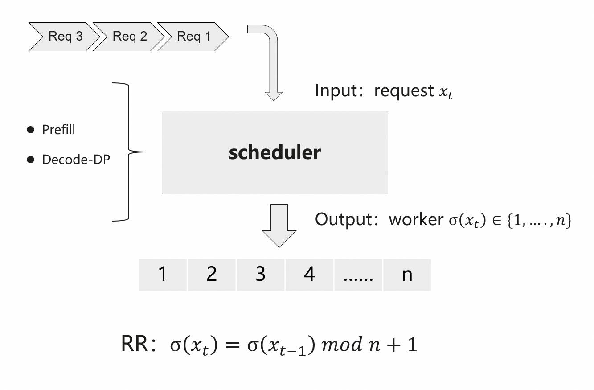
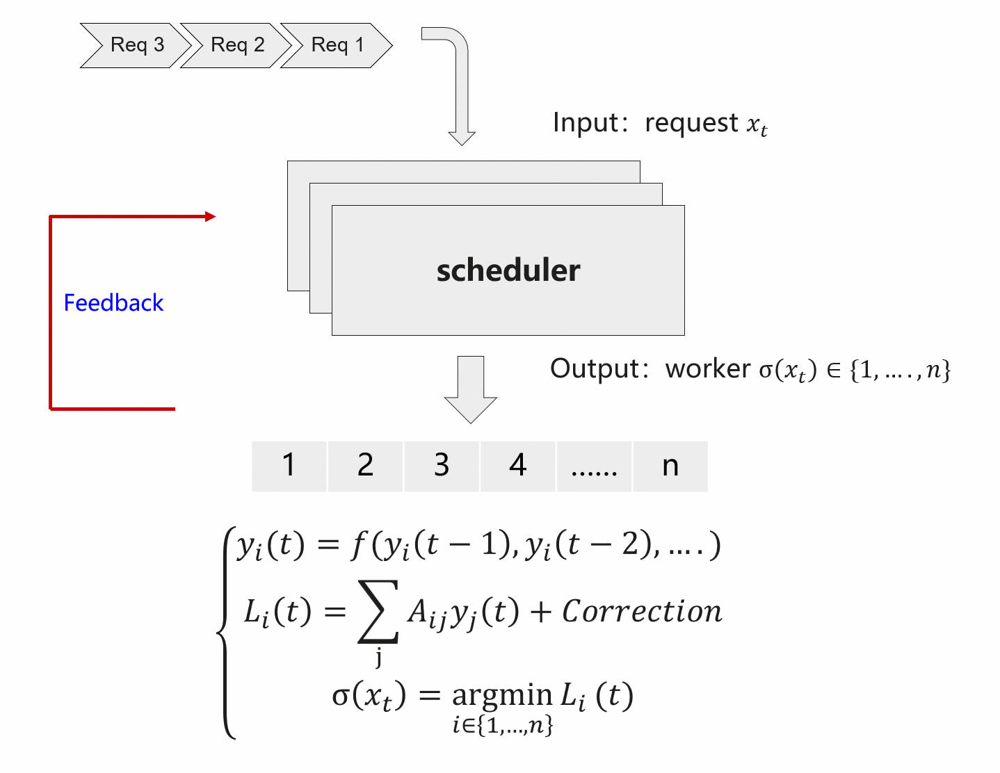
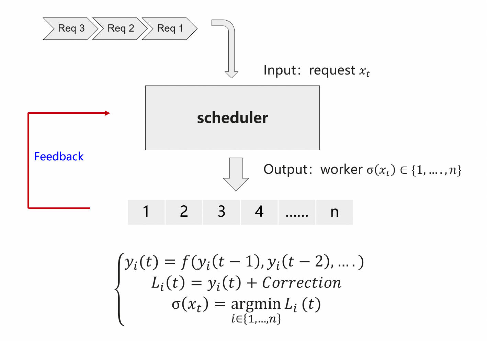

# Scheduling Algorithms

[English](load-balancing.md) | [简体中文](load-balancing.zh-CN.md)

## Overview

In inference services, the scheduler is responsible for distributing incoming requests to appropriate worker instances. Under the PD disaggregation architecture, the Prefill and Decode phases each need to dispatch requests to their respective instances for execution.

The system supports the following four scheduling algorithms:

| Algorithm | Use Case | Core Strategy |
|---|---|---|
| round-robin | Simple scenarios, both Prefill and Decode sides | Round-robin dispatch |
| least-total-load | Prefill-side load balancing | Least load first based on load formula |
| apc | Prefill side with KV Cache reuse | Prefix cache awareness + load prediction |
| abc6 | Decode-side load balancing | State awareness + memory correction + overload penalty |

---

## round-robin

### 1. Principle

The most basic scheduling algorithm that distributes requests to instances in round-robin order. It has high robustness and is applicable to a wide range of scenarios, but does not perceive instance load status and only ensures even distribution of requests across instances. When request sequence lengths vary significantly, true load balancing across instances cannot be guaranteed, potentially causing the fast-slow card effect.


<center>Round-Robin Scheduling Algorithm Diagram</center>

This algorithm has no state awareness and no load modeling. It is simple to implement with minimal overhead, and can serve as a fallback algorithm for other algorithms.

### 2. Scheduling Logic

1. Maintain an instance list and a current index `currIndex`.
2. On each incoming request, `currIndex` is incremented modulo the number of instances to select the corresponding instance.
3. If the target instance is in the blacklist, skip it and try the next one.
4. No metrics collection is needed (`NeedStatsList` is empty), and no periodic updates are required.

### 3. Configuration Parameters

No additional configuration parameters required.

---

## least-total-load

### 1. Principle

Based on request Token length and BatchSize constraints, the load formula calculates the load value of each instance and dispatches requests to the instance with the lowest load. Suitable for the Prefill side — each request is completed in a single step, and the load can be measured by the sum of dispatched Token lengths.

**Load Modeling:** The load of each request is approximated by its Prompt Token length:

$$l_q \approx \text{length}(q)$$

The instance load calculation formula introduces a BatchSize penalty term:

$$\text{Load} = \text{total\_len} \times \frac{\lceil \text{req\_num} / \text{batchsize} \rceil + 1}{2}$$

- When `req_num < batchsize`, the load equals the sum of Token lengths.
- When `req_num >= batchsize`, the load equals the sum of Token lengths multiplied by 1.5 (assuming `req_num` just exceeds `batchsize`), acting as a soft penalty to avoid sending requests to instances whose BatchSize is already full. Each round of calculation uses the current request count to determine whether to apply the penalty coefficient.

**Memory Correction:** The scheduler immediately adds the estimated load after dispatching a request (request count +1, Token length plus the current request length), and subtracts it when the request completes. Even with metric feedback delays, scheduling decisions are still based on the latest load estimates, preventing a large number of requests from being concentrated on the same instance in a short period.


<center>least-total-load Scheduling Algorithm Diagram</center>

### 2. Scheduling Logic

1. On each incoming request, calculate the load of each instance using the load formula and sort in ascending order, excluding the current new request.
2. Dispatch the request to the instance with the lowest load; skip blacklisted instances if any.
3. Immediately update the instance's request count and Token length accumulation after dispatch (memory correction).
4. When a request completes, subtract that request's load from the corresponding instance to update the load estimate in a timely manner.

### 3. Configuration Parameters

| Parameter | Description | Default |
|---|---|---|
| max_num_seqs | Maximum BatchSize per instance | 16 |
| verbose | Whether to print detailed load logs | false |

---

## apc

### 1. Principle

The APC (Aware Prefix Cache) algorithm adds prefix cache awareness on top of least-total-load. When a request's Prompt has a prefix match with an instance's existing KV Cache, dispatching the request to that instance enables cache reuse and reduces redundant computation. Suitable for Prefill-side scenarios with KV Cache reuse, such as multi-turn conversations.

**Architecture:** APC consists of two layers:

1. **APCScheduler**: The scheduler layer, responsible for load calculation, instance selection, and load increment/decrement management.
2. **APCManager**: The global manager, responsible for cache lookup, matching, update, and persistence, supporting cross-scheduler collaboration through shared memory.

**Cache Matching Strategy:** Currently supports the RollingHash strategy — it partitions the Prompt into fixed-size blocks (`block-size-bytes`), computes the rolling hash of each block, and looks up instances with prefix matches in the cache through hash values, returning the match ratio (`matched_ratio`). It also supports the Progressive Block strategy, which performs coarse filtering with larger-grained blocks first, then fine-grained matching.

**Load Modeling:** Based on the least-total-load formula, the request's Prompt Token length is reduced by the match ratio:

$$\text{reqLen} = \text{prompt\_tokens} \times (1 - \text{matched\_ratio}) + \text{prefix\_load\_base}$$

$$\text{Load} = \text{total\_len} \times \frac{\lceil \text{req\_num} / \text{batchsize} \rceil + 1}{2}$$

The higher the match ratio, the smaller the load contribution of the request to the instance, thereby guiding the scheduler to prefer instances with cache reuse advantages.

### 2. Scheduling Logic

1. Obtain the cache match ratio (`matchedInstances`) for each instance from the APCManager.
2. For each available instance, pre-calculate the predicted load after adding this request.
3. Select the instance with the lowest predicted load; if loads are equal, select the instance with the highest match ratio.
4. Update instance load and request dispatch records after dispatch.

**Cache Update:** The APC cache is updated only after a request successfully completes the Prefill phase (`RequestPrefillSuccess` event), ensuring that the KV Cache actually exists. Cache update operations are performed only by the cluster Leader node.

**Degradation Mechanism:** When APC is not enabled or unavailable (e.g., Manager not initialized, non-Leader node), `DispatchRequest` returns an error, and the scheduler automatically degrades to the fallback algorithm (round-robin).

### 3. Configuration Parameters

**Scheduler Parameters:**

| Parameter | Description | Default |
|---|---|---|
| default-batch-size | Default BatchSize | 16 |
| prefix-load-base | Minimum prefix load base | 1 |

**Manager Parameters:**

| Parameter | Description | Default |
|---|---|---|
| enable | Whether to enable APC | false |
| strategies.hash.block-size-bytes | Block size (bytes) | 64 |
| strategies.hash.max-blocks | Maximum number of blocks | 128 |
| strategies.hash.max-entries | Maximum number of cache entries | 100000 |
| strategies.hash.max-memory-mb | Maximum cache memory (MB) | 512 |
| strategies.hash.cache-ttl-sec | Cache TTL (seconds) | 3600 |
| strategies.hash.progressive-base-block-size-bytes | Progressive block base size | 256 |
| persistence.enable | Whether to enable persistence | false |
| persistence.provider | Persistence provider | - |

---

## abc6

### 1. Principle

A load balancing algorithm for the Decode side, integrating three key mechanisms: state awareness, memory correction, and overload penalty. In the Decode phase, requests execute over multiple steps, and load cannot be characterized by request count alone. It requires a comprehensive decision combining Token length, waiting queue, and running queue status.

**State Awareness:** The following metrics are obtained from the inference engine and reported back to the scheduler:

| Metric | Description |
|---|---|
| PromptTokensTotal + GenerationTokensTotal | Current total Token length |
| NumRequestsWaiting | Current number of requests in the waiting queue |
| NumRequestsRunning | Current number of requests in the running queue |

**Memory Correction:** There is a delay from request dispatch to actual execution and then to load metric feedback. Relying solely on feedback metrics would cause requests to be concentrated on the instance that "appears to have the lowest load" in a short period. The abc6 memory correction mechanism is as follows:

- When dispatching a request, immediately add the estimated load to the target instance. Based on the current system state, there are two update modes:
  - When the sort type is TokenLoads (partial overload / no overload): `TokenLoads += reqLen`, `RunningQueue += 1`
  - When the sort type is WaitingQueue (all overloaded): `WaitingQueue += 1`, TokenLoads and RunningQueue remain unchanged
- When collected data is updated, update the load estimate to the latest collected data.

**Overload Determination and Penalty:** When an instance is queuing or about to queue, it is considered overloaded or nearing overload, and fewer requests should be sent to it. Based on practical experience, instance overload often occurs very quickly, so advance prediction is needed. The conditions for determining instance overload:

```
WaitingQueue >= 2  or  RunningQueue >= batchsize - 1
```

Overloaded instances are penalized during sorting, causing them to rank lower.


<center>abc6 Scheduling Algorithm Diagram</center>

### 2. Scheduling Logic

1. Check whether all instances are overloaded:
   - **All overloaded**: Sort by waiting request count (`WaitingQueue`), select the instance with the fewest waiting requests, degrading to a request-count-based balancing strategy.
   - **Partially overloaded**: Sort by Token length load, apply penalty to overloaded instances, select the non-overloaded instance with the lowest load.
2. Skip blacklisted instances in the sorted results and select the first available instance.
3. Update memory load after dispatch.
4. Update load estimates promptly when collected data is refreshed.


### 3. Configuration Parameters

| Parameter | Description | Default |
|---|---|---|
| max_num_seqs | Maximum BatchSize per instance | 16 |

---

## Algorithm Selection and Configuration

Scheduling algorithms are specified through configuration files. Each request type (InstanceRole, e.g., `prefill`, `decode`) can independently configure its scheduling algorithm. When the primary scheduling algorithm fails, the system automatically degrades to the fallback algorithm (round-robin).

### Configuration Example

```yaml
schedulers:
  - instance-role: decode
    scheduler-name: abc6
    params:
      max_num_seqs: 32
      update-interval-ms: 500
      metrics-overdue-int-ms: 1000

  - instance-role: prefill
    scheduler-name: least-total-load
    params:
      max_num_seqs: 16
      verbose: false

  # Prefill scheduling with cache awareness
  - instance-role: prefill
    scheduler-name: apc
    params:
      default-batch-size: 16
      prefix-load-base: 1
```

### SLO Grouping

For the Prefill side, SLO (Service Level Objective) group-based scheduling is supported. When enabled, requests of different SLO levels are managed by independent algorithm instances, ensuring that high-priority requests receive better scheduling resources. Each SLO group has its own independent fallback algorithm.

### Multi-Scheduler Coordination

Under high-concurrency scenarios, multiple scheduler instances process requests in parallel. abc6 and least-total-load protect shared state through read-write locks; APC achieves cross-scheduler cache sharing through a global Manager instance. Each scheduler can read the load status of all instances when dispatching requests, enabling globally optimal decisions.

---

## Algorithm Comparison

| Dimension | round-robin | least-total-load | apc | abc6 |
|---|---|---|---|---|
| Load Awareness | None | Token length + BatchSize penalty | Token length + Cache match + BatchSize penalty | Token length + Queue status + Overload penalty |
| Metrics Collection | None | None (self-maintained) | 4 metrics + Cache lookup | 4 metrics |
| Applicable Phase | Any | Prefill | Prefill (KV Cache reuse scenarios) | Decode |
| Cache Awareness | None | None | Yes (RollingHash strategy) | None |
| Overload Protection | None | Soft penalty (formula coefficient) | Soft penalty (formula coefficient) | Hard determination + Penalty value |
| Memory Correction | None | Yes | Yes | Yes |
| Complexity | O(1) | O(n log n) | O(n log n) + Cache lookup | O(n log n) |
| Fallback | - | round-robin | round-robin | round-robin |
