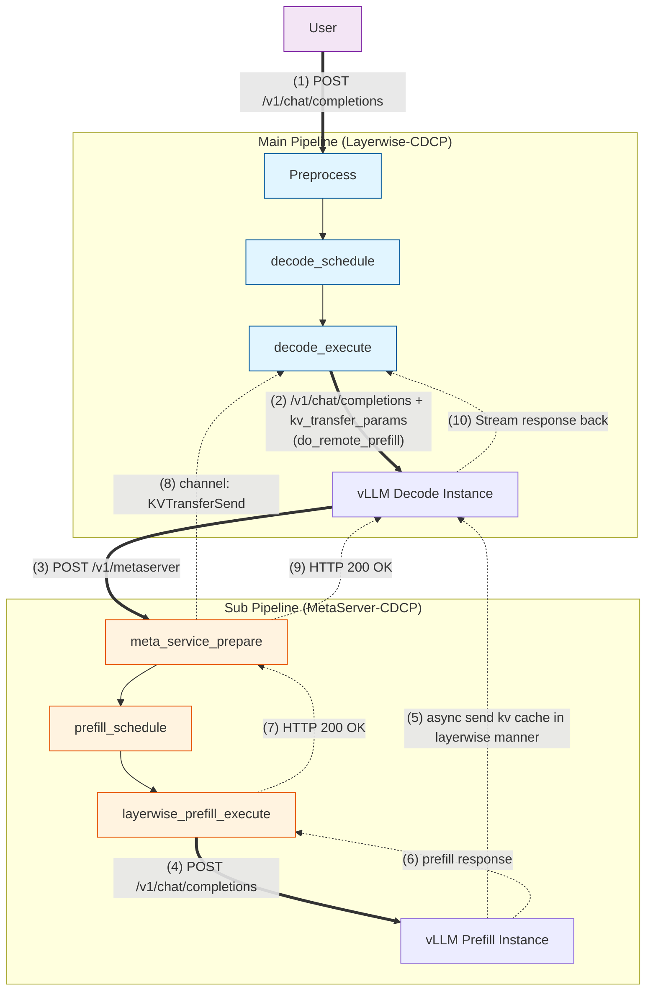

# Layerwise CDCP

[English](layerwise-cdcp.md) | [简体中文](layerwise-cdcp.zh-CN.md)

## Deployment Mode Overview

Layerwise CDCP (Client -> Decode -> Client -> Prefill, see [vllm-ascend issue](https://github.com/vllm-project/vllm-ascend/issues/4842)) is a layer-wise disaggregated deployment mode in RouteServer. In this mode, Prefill is handled by a remote compute node, and the current node only handles the Decode stage. The vLLM instance on the current node receives KV Cache from the remote prefill node in a layer-wise manner, avoiding the need for full KV Cache transfer upfront.

In this mode:

- **Remote Compute Node** handles the Prefill stage, computing KV Cache for each transformer layer.
- **Current Node** runs the Decode stage only, receiving KV Cache layer by layer from the remote prefill node.
- **vLLM Decode Instance** on the current node communicates with RouteServer via the `/v1/metaserver` endpoint to coordinate prefill completion signaling and KV transfer parameter exchange.

This mode is suitable for scenarios where:

- Prefill and Decode are deployed on separate nodes with layer-wise KV Cache transfer
- The compute node that performs Prefill needs to push KV Cache incrementally to the Decode node
- Full disaggregation with layer-wise pipeline parallelism is desired

### Enabling Layerwise CDCP Mode

Layerwise CDCP mode is enabled by setting `infer-mode` to `Layerwise-CDCP`:

```bash
deploy.sh ... --infer-mode Layerwise-CDCP ...
```

The valid infer mode value for Layerwise CDCP is `Layerwise-CDCP`.

### Supported API Endpoints

Layerwise CDCP mode supports the following OpenAI-compatible endpoints:

- `POST /v1/chat/completions` — Chat completions
- `POST /v1/completions` — Text completions

## Pipeline Definition

### Pipeline Configuration

The Layerwise CDCP pipeline consists of a **main pipeline** and a **sub pipeline** that work together to coordinate the Decode and Prefill stages:

| Pipeline | Infer Mode | Configuration |
|---|---|---|
| **Main Pipeline** | `Layerwise-CDCP` | [deploy/pipelines/layerwise_cdcp.yaml](../../deploy/pipelines/layerwise_cdcp.yaml) |
| **Sub Pipeline** | `MetaServer-CDCP` | [deploy/pipelines/metaserver_cdcp.yaml](../../deploy/pipelines/metaserver_cdcp.yaml) |

#### Main Pipeline Phases

| Phase | Type | Instance Role | Depends On |
|---|---|---|---|
| `decode_schedule` | Schedule | decode | — |
| `decode_execute` | Execute | decode | `decode_schedule` |

#### Sub Pipeline Phases

| Phase | Type | Instance Role | Depends On |
|---|---|---|---|
| `layer_meta_server_prepare` | Prepare (custom) | — | — |
| `prefill_schedule` | Schedule | prefill | — |
| `layerwise_prefill_execute` | Execute | prefill | `prefill_schedule` |

### Execution Flow

The pipeline involves two coordinated execution paths — the main pipeline and the sub pipeline — that communicate via shared `PipelineContext` and channel-based synchronization:



The detailed steps are:

1. **Preprocess** (built-in): Parse the request body, validate parameters, extract prompt length and other metadata.

2. **decode_schedule** (Schedule Phase): Schedule an appropriate Decode instance based on the configured scheduling algorithm and request load metrics (`usage`, `text`, `bytes`). The selected instance address is written into PipelineContext.

3. **decode_execute** (Execute Phase, step ① in flowchart): This phase performs request preparation and sends the request:
   - Two pre-processing functions are applied in sequence:
     - `decode_prepare_request`: Prepares the base Decode request (preserves streaming options, original `max_tokens`, etc.).
     - `layerwise_prepare_request`: Injects `kv_transfer_params` into the request body, including:
       - `metaserver`: The URL of RouteServer's `/v1/metaserver` endpoint, telling the vLLM instance where to send the prefill callback request.
       - `do_remote_decode`: Set to `false` — decode is handled locally on this vLLM instance.
       - `do_remote_prefill`: Set to `true` — prefill was/will be done by a remote compute node.
       - `request_id`: The unique request identifier for correlation.
   - The prepared request is sent to the scheduled vLLM Decode instance.

4. **vLLM Decode Instance Receives Request** (step ②): The vLLM Decode instance receives the request with `kv_transfer_params` containing `do_remote_prefill=true` and the `metaserver` URL for callbacks.

5. **Sub Pipeline Trigger** (step ③): The vLLM Decode instance detects the `metaserver` field in `kv_transfer_params` and sends an HTTP POST request to `/v1/metaserver` on RouteServer, triggering the sub pipeline.

6. **Sub Pipeline Execution — meta_service_prepare** (Prepare Phase): Parses the incoming metaserver request body, extracts `kv_transfer_params`, and identifies the original request's `PipelineContext` via `request_id`. It then calls `SetKVTransferParams()` to store the KV transfer parameters on the shared context and signals the main pipeline via the `KVTransferSend` channel.

7. **prefill_schedule** (Schedule Phase): Schedules an appropriate Prefill instance for the prefill sub-request.

8. **layerwise_prefill_execute** (Execute Phase, step ④): Constructs and sends a Prefill request to the scheduled Prefill instance. This phase uses `prefill_stream_prepare_request` (sets `max_tokens=1`, disables streaming for non-chat) and `set_kv_transfer_params` (re-injects the KV transfer params from metaserver).

9. **Prefill Instance Processing**: The vLLM Prefill instance receives the request and performs the following:
   - Computes KV Cache for each transformer layer.
   - Sends KV Cache to the Decode instance layer by layer asynchronously (step ⑤).
   - Returns the prefill response (containing `kv_transfer_params` and usage information) back to the sub pipeline's `layerwise_prefill_execute` phase (step ⑥).

   The Prefill response is then processed by `prefill_stream_post_response`, which streams the prefill response back to the main pipeline's Gin context and handles the first-token-from-prefill logic.

10. **Sub Pipeline Success** (step ⑦): On success, `layerwise_success` phase returns HTTP 200 to the metaserver prepare phase.

11. **KVTransferSend Signal** (step ⑧): The `meta_service_prepare` phase signals the main pipeline's `decode_execute` that KV transfer params are ready via the `KVTransferSend` channel.

12. **Metaserver Response** (step ⑨): The metaserver prepare phase returns HTTP 200 OK to the vLLM Decode instance, confirming that prefill processing is complete.

13. **Decode Response Streaming** (step ⑩): The vLLM Decode instance, now receiving KV Cache layer by layer from the Prefill instance, generates tokens and streams the Decode response back to the main pipeline's `decode_execute` phase. The main pipeline writes the response to the client.

14. **PostProcess** (built-in): Finalize the request, update metrics, handle any errors.

### Request Construction

#### Decode Request Construction (`decode_prepare_request` + `layerwise_prepare_request`)

The Decode request is constructed by applying two pre-processing functions in sequence:

1. **`decode_prepare_request`**: Prepares the base Decode request:
   - Preserves `stream` and `stream_options` from the original client request.
   - Preserves the original `max_tokens` value.
   - Injects `kv_transfer_params` if available from a prior Encode phase.

2. **`layerwise_prepare_request`** (`PrepareLayerwiseRequestBody`): Injects layerwise-specific KV transfer parameters into the request body:
   - `do_remote_decode`: `false` — decode is performed locally.
   - `do_remote_prefill`: `true` — prefill is performed remotely.
   - `metaserver`: The URL of RouteServer's `/v1/metaserver` endpoint.
   - `request_id`: The unique identifier for correlating the metaserver callback.

**Example — Client sends a streaming chat completion request:**

```json
{
  "model": "my-model",
  "messages": [
    {"role": "user", "content": "Explain quantum computing in simple terms"}
  ],
  "stream": true,
  "stream_options": {"include_usage": true},
  "max_tokens": 1024,
  "temperature": 0.7
}
```

**The Decode request forwarded to the vLLM instance is modified to:**

```json
{
  "model": "my-model",
  "messages": [
    {"role": "user", "content": "Explain quantum computing in simple terms"}
  ],
  "stream": true,
  "stream_options": {"include_usage": true},
  "max_tokens": 1024,
  "temperature": 0.7,
  "kv_transfer_params": {
    "do_remote_decode": false,
    "do_remote_prefill": true,
    "metaserver": "http://routeserver-host:port/v1/metaserver",
    "request_id": "req-abc-123"
  }
}
```

#### Prefill Request Construction (`prefill_stream_prepare_request` + `set_kv_transfer_params`)

The Prefill request in the sub pipeline is constructed by applying two pre-processing functions:

1. **`prefill_stream_prepare_request`** (`PreparePrefillStreamRequestBody`):
   - Forces `max_tokens=1` (and `max_completion_tokens=1` if present). Only need to compute KV Cache.
   - Disables streaming: `"stream": false` is forced for non-chat; for streaming chat, `stream_options` is removed.
   - Strips existing `kv_transfer_params` (these come from the metaserver path).
   - Injects `ec_transfer_params` if present from a prior Encode stage.

2. **`set_kv_transfer_params`** (`PrepareRequestBodyWithKV`): Re-injects the `kv_transfer_params` that were parsed from the metaserver request body during the `meta_service_prepare` phase.

**Example — The Prefill request forwarded to the vLLM Prefill instance:**

```json
{
  "model": "my-model",
  "messages": [
    {"role": "user", "content": "Explain quantum computing in simple terms"}
  ],
  "stream": false,
  "max_tokens": 1,
  "temperature": 0.7,
  "kv_transfer_params": {
    "do_remote_decode": false,
    "do_remote_prefill": true,
    "metaserver": "http://routeserver-host:port/v1/metaserver",
    "request_id": "req-abc-123"
  }
}
```

### Sub Pipeline Communication

The main pipeline and sub pipeline communicate through shared `PipelineContext` and channel-based synchronization:

| Mechanism | Direction | Description |
|---|---|---|
| **`KVTransferSend` channel** | Sub → Main | The `meta_service_prepare` phase in the sub pipeline calls `SetKVTransferParams()` to store KV transfer params on the shared context and close the `KVTransferSend` channel, signaling the main pipeline that KV params are ready. |
| **Shared `RequestContext`** | Bidirectional | The sub pipeline's `parseMetaRequest` function locates the main pipeline's `PipelineContext` via `request_id` and shares the `RequestContext` (including `ParsedRequest`, `Tracer`, `DoneChannel`, etc.) between both pipelines. |
| **`DoneChannel`** | Main → Sub | When the main pipeline completes, `SetDone()` is called to close the `DoneChannel`, signaling any waiting phases in the sub pipeline (used primarily in the CPCD variant). |

### Response Handling

#### Decode Response (`decode_post_response`)

The Decode response is written back to the client:

- **Streaming**: The response is forwarded chunk by chunk using SSE (Server-Sent Events). Both V1 and legacy streaming writers are supported.
- **Non-streaming**: The full response body is written at once.

#### Prefill Response (`prefill_stream_post_response`)

The Prefill response is not forwarded to the client. Instead:

- **Streaming Chat**: The prefill response tokens are streamed into the main pipeline's Gin context for potential reuse during the Decode stage.
- **Non-streaming**: The full response body is read.
- **First Token Handling**: In layerwise mode, the first token produced by Prefill is marked as "skip in decode" by default (since the Decode instance will generate its own first token). This can be overridden by `ForceReuseFirstToken`.

#### Metaserver Success/Failure

- **`layerwise_success`**: Returns HTTP 200 OK to the vLLM instance, indicating that the prefill sub-request completed successfully. A trace event `metaserver_done` is recorded.
- **`layerwise_error`**: Returns HTTP 503 Service Unavailable to the vLLM instance, indicating that the prefill sub-request failed. A trace event `metaserver_error` is recorded.

#### Post-Phase Processing

After the response is sent, the following metrics are computed and recorded into trace log:

| Metric | Description |
|---|---|
| **TTFT** (Time to First Token) | Time from request start to first output token |
| **TPOT** (Time Per Output Token) | Average time per output token during Decode |
| **Latency** | Total request latency |
| **First Token Latency** | Time from Decode start to first token |
| **First D-Token Latency** | Time from first Decode token to second token |
| **Second D-Token Latency** | Time between first and second Decode tokens |

### Related Documentation

- [About Infer Pipeline](./about-infer-pipeline.md)
- [PD Hybrid](./pd-hybrid.md)
- [PD Disaggregate](./pd-disaggregate.md)
- [EPD Disaggregate](./epd-disaggregate.md)
