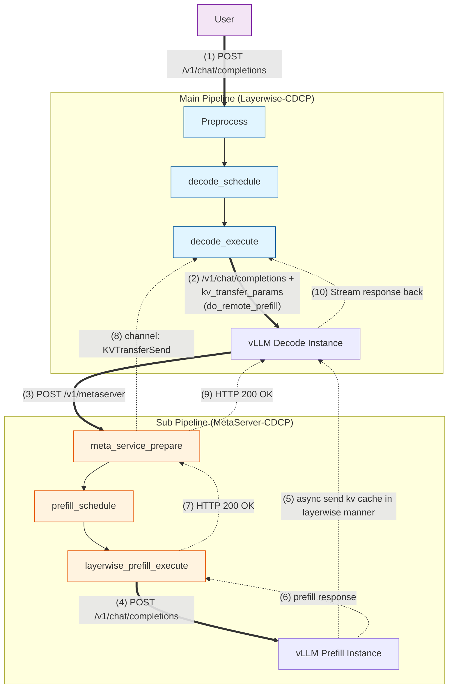

# Layerwise CDCP

[English](layerwise-cdcp.md) | [简体中文](layerwise-cdcp.zh-CN.md)

## 部署模式概述

Layerwise CDCP（Client -> Decode -> Client -> Prefill，参见 [vllm-ascend issue](https://github.com/vllm-project/vllm-ascend/issues/4842)）是 RouteServer 中的一种分层分离部署模式。该模式下，Prefill 由远端计算节点处理，当前节点只负责 Decode 阶段。当前节点上的 vLLM 实例以分层方式从远端 Prefill 节点接收 KV Cache，从而无需事先完成全量 KV Cache 传输。

在该模式下：

- **远端计算节点**负责 Prefill 阶段，逐个 transformer 层计算 KV Cache。
- **当前节点**只运行 Decode 阶段，从远端 Prefill 节点逐层接收 KV Cache。
- 当前节点上的 **vLLM Decode 实例**通过 `/v1/metaserver` 端点与 RouteServer 通信，协调 Prefill 完成信号与 KV 传输参数交换。

该模式适用于以下场景：

- Prefill 与 Decode 部署在不同节点上，并采用分层 KV Cache 传输
- 执行 Prefill 的计算节点需要向 Decode 节点增量推送 KV Cache
- 需要具备分层流水线并行的完全分离

### 启用 Layerwise CDCP 模式

将 `infer-mode` 设为 `Layerwise-CDCP` 即可启用 Layerwise CDCP 模式：

```bash
deploy.sh ... --infer-mode Layerwise-CDCP ...
```

Layerwise CDCP 对应的合法 infer mode 取值为 `Layerwise-CDCP`。

### 支持的 API 端点

Layerwise CDCP 模式支持以下 OpenAI 兼容端点：

- `POST /v1/chat/completions` — Chat 补全
- `POST /v1/completions` — 文本补全

## 流水线定义

### 流水线配置

Layerwise CDCP 流水线由一个**主流水线**和一个**子流水线**组成，二者协同完成 Decode 与 Prefill 阶段的调度：

| 流水线 | Infer Mode | 配置 |
|---|---|---|
| **主流水线** | `Layerwise-CDCP` | [deploy/pipelines/layerwise_cdcp.yaml](../../deploy/pipelines/layerwise_cdcp.yaml) |
| **子流水线** | `MetaServer-CDCP` | [deploy/pipelines/metaserver_cdcp.yaml](../../deploy/pipelines/metaserver_cdcp.yaml) |

#### 主流水线阶段

| 阶段 | 类型 | 实例角色 | 依赖 |
|---|---|---|---|
| `decode_schedule` | Schedule | decode | — |
| `decode_execute` | Execute | decode | `decode_schedule` |

#### 子流水线阶段

| 阶段 | 类型 | 实例角色 | 依赖 |
|---|---|---|---|
| `layer_meta_server_prepare` | Prepare（自定义） | — | — |
| `prefill_schedule` | Schedule | prefill | — |
| `layerwise_prefill_execute` | Execute | prefill | `prefill_schedule` |

### 执行流程

该流水线包含两条协同执行的路径——主流水线与子流水线——它们通过共享的 `PipelineContext` 和基于 channel 的同步机制通信：



具体步骤如下：

1. **Preprocess**（内置）：解析请求体，校验参数，提取 prompt 长度等元数据。

2. **decode_schedule**（Schedule 阶段）：根据配置的调度算法和请求负载指标（`usage`、`text`、`bytes`）调度合适的 Decode 实例。所选实例地址写入 PipelineContext。

3. **decode_execute**（Execute 阶段，流程图中步骤 ①）：该阶段执行请求准备并发送请求：
   - 依次应用两个预处理函数：
     - `decode_prepare_request`：准备基础 Decode 请求（保留流式选项、原始 `max_tokens` 等）。
     - `layerwise_prepare_request`：向请求体注入 `kv_transfer_params`，其中包括：
       - `metaserver`：RouteServer 的 `/v1/metaserver` 端点 URL，用于告知 vLLM 实例将 prefill 回调请求发往何处。
       - `do_remote_decode`：设为 `false` —— 解码由本 vLLM 实例在本地完成。
       - `do_remote_prefill`：设为 `true` —— prefill 已由/将由远端计算节点完成。
       - `request_id`：用于关联的唯一请求标识。
   - 准备好的请求被发送到调度出的 vLLM Decode 实例。

4. **vLLM Decode 实例接收请求**（步骤 ②）：vLLM Decode 实例收到请求，其中的 `kv_transfer_params` 包含 `do_remote_prefill=true` 以及用于回调的 `metaserver` URL。

5. **子流水线触发**（步骤 ③）：vLLM Decode 实例检测到 `kv_transfer_params` 中的 `metaserver` 字段，向 RouteServer 的 `/v1/metaserver` 发送 HTTP POST 请求，从而触发子流水线。

6. **子流水线执行 —— meta_service_prepare**（Prepare 阶段）：解析传入的 metaserver 请求体，提取 `kv_transfer_params`，并通过 `request_id` 定位原始请求的 `PipelineContext`。随后调用 `SetKVTransferParams()` 将 KV 传输参数存储到共享上下文，并通过 `KVTransferSend` channel 通知主流水线。

7. **prefill_schedule**（Schedule 阶段）：为 prefill 子请求调度合适的 Prefill 实例。

8. **layerwise_prefill_execute**（Execute 阶段，步骤 ④）：构造 Prefill 请求并发送给调度出的 Prefill 实例。该阶段使用 `prefill_stream_prepare_request`（设置 `max_tokens=1`，对非 chat 请求禁用流式）和 `set_kv_transfer_params`（重新注入来自 metaserver 的 KV 传输参数）。

9. **Prefill 实例处理**：vLLM Prefill 实例接收请求并执行以下操作：
   - 为每个 transformer 层计算 KV Cache。
   - 以异步方式逐层将 KV Cache 发送给 Decode 实例（步骤 ⑤）。
   - 将 Prefill 响应（包含 `kv_transfer_params` 和 usage 信息）返回给子流水线的 `layerwise_prefill_execute` 阶段（步骤 ⑥）。

   Prefill 响应随后由 `prefill_stream_post_response` 处理，该函数把 Prefill 响应流式写回主流水线的 Gin 上下文，并处理「首 token 来自 Prefill」的逻辑。

10. **子流水线成功**（步骤 ⑦）：成功时，`layerwise_success` 阶段向 metaserver prepare 阶段返回 HTTP 200。

11. **KVTransferSend 信号**（步骤 ⑧）：`meta_service_prepare` 阶段通过 `KVTransferSend` channel 通知主流水线的 `decode_execute`：KV 传输参数已就绪。

12. **Metaserver 响应**（步骤 ⑨）：metaserver prepare 阶段向 vLLM Decode 实例返回 HTTP 200 OK，确认 prefill 处理已完成。

13. **Decode 响应流式返回**（步骤 ⑩）：vLLM Decode 实例此时已逐层收到来自 Prefill 实例的 KV Cache，生成 token 并将 Decode 响应流式返回给主流水线的 `decode_execute` 阶段。主流水线将响应写给客户端。

14. **PostProcess**（内置）：收尾请求，更新指标，处理错误。

### 请求构造

#### Decode 请求构造（`decode_prepare_request` + `layerwise_prepare_request`）

Decode 请求通过依次应用两个预处理函数构造：

1. **`decode_prepare_request`**：准备基础 Decode 请求：
   - 保留原始客户端请求中的 `stream` 与 `stream_options`。
   - 保留原始 `max_tokens` 值。
   - 若前序 Encode 阶段提供了 `kv_transfer_params`，则注入。

2. **`layerwise_prepare_request`**（`PrepareLayerwiseRequestBody`）：向请求体注入分层模式专用的 KV 传输参数：
   - `do_remote_decode`：`false` —— 解码在本地执行。
   - `do_remote_prefill`：`true` —— prefill 在远端执行。
   - `metaserver`：RouteServer 的 `/v1/metaserver` 端点 URL。
   - `request_id`：用于关联 metaserver 回调的唯一标识。

**示例 —— 客户端发送流式 chat 补全请求：**

```json
{
  "model": "my-model",
  "messages": [
    {"role": "user", "content": "Explain quantum computing in simple terms"}
  ],
  "stream": true,
  "stream_options": {"include_usage": true},
  "max_tokens": 1024,
  "temperature": 0.7
}
```

**转发给 vLLM 实例的 Decode 请求会被修改为：**

```json
{
  "model": "my-model",
  "messages": [
    {"role": "user", "content": "Explain quantum computing in simple terms"}
  ],
  "stream": true,
  "stream_options": {"include_usage": true},
  "max_tokens": 1024,
  "temperature": 0.7,
  "kv_transfer_params": {
    "do_remote_decode": false,
    "do_remote_prefill": true,
    "metaserver": "http://routeserver-host:port/v1/metaserver",
    "request_id": "req-abc-123"
  }
}
```

#### Prefill 请求构造（`prefill_stream_prepare_request` + `set_kv_transfer_params`）

子流水线中的 Prefill 请求通过应用两个预处理函数构造：

1. **`prefill_stream_prepare_request`**（`PreparePrefillStreamRequestBody`）：
   - 强制 `max_tokens=1`（若存在 `max_completion_tokens=1` 也一并强制）。此时只需计算 KV Cache。
   - 禁用流式：非 chat 请求强制 `"stream": false`；流式 chat 请求则移除 `stream_options`。
   - 剥离已有的 `kv_transfer_params`（这些参数来自 metaserver 路径）。
   - 若前序 Encode 阶段提供了 `ec_transfer_params`，则注入。

2. **`set_kv_transfer_params`**（`PrepareRequestBodyWithKV`）：重新注入在 `meta_service_prepare` 阶段从 metaserver 请求体解析出的 `kv_transfer_params`。

**示例 —— 转发给 vLLM Prefill 实例的 Prefill 请求：**

```json
{
  "model": "my-model",
  "messages": [
    {"role": "user", "content": "Explain quantum computing in simple terms"}
  ],
  "stream": false,
  "max_tokens": 1,
  "temperature": 0.7,
  "kv_transfer_params": {
    "do_remote_decode": false,
    "do_remote_prefill": true,
    "metaserver": "http://routeserver-host:port/v1/metaserver",
    "request_id": "req-abc-123"
  }
}
```

### 子流水线通信

主流水线与子流水线通过共享的 `PipelineContext` 和基于 channel 的同步机制通信：

| 机制 | 方向 | 说明 |
|---|---|---|
| **`KVTransferSend` channel** | 子 → 主 | 子流水线中的 `meta_service_prepare` 阶段调用 `SetKVTransferParams()`，把 KV 传输参数存到共享上下文并关闭 `KVTransferSend` channel，从而通知主流水线 KV 参数已就绪。 |
| **共享 `RequestContext`** | 双向 | 子流水线的 `parseMetaRequest` 函数通过 `request_id` 定位主流水线的 `PipelineContext`，并在两条流水线之间共享 `RequestContext`（含 `ParsedRequest`、`Tracer`、`DoneChannel` 等）。 |
| **`DoneChannel`** | 主 → 子 | 主流水线完成时调用 `SetDone()` 关闭 `DoneChannel`，通知子流水线中所有等待中的阶段（主要用于 CPCD 变体）。 |

### 响应处理

#### Decode 响应（`decode_post_response`）

Decode 响应写回客户端：

- **流式**：使用 SSE（Server-Sent Events）逐块转发响应。同时支持 V1 与旧版流式写出器。
- **非流式**：一次性写出完整响应体。

#### Prefill 响应（`prefill_stream_post_response`）

Prefill 响应不会转发给客户端。取而代之的是：

- **流式 Chat**：prefill 响应的 token 被流式写入主流水线的 Gin 上下文，供 Decode 阶段按需复用。
- **非流式**：读取完整响应体。
- **首 token 处理**：在分层模式下，Prefill 产生的首个 token 默认标记为「在 Decode 中跳过」（因为 Decode 实例会生成自己的首个 token）。该行为可通过 `ForceReuseFirstToken` 覆盖。

#### Metaserver 成功/失败

- **`layerwise_success`**：向 vLLM 实例返回 HTTP 200 OK，表示 prefill 子请求成功完成。同时记录 trace 事件 `metaserver_done`。
- **`layerwise_error`**：向 vLLM 实例返回 HTTP 503 Service Unavailable，表示 prefill 子请求失败。同时记录 trace 事件 `metaserver_error`。

#### 后置阶段处理

响应发送后，计算以下指标并记录到 trace 日志：

| 指标 | 说明 |
|---|---|
| **TTFT**（Time to First Token） | 从请求开始到首个输出 token 的时间 |
| **TPOT**（Time Per Output Token） | Decode 期间每个输出 token 的平均耗时 |
| **Latency** | 请求总延迟 |
| **First Token Latency** | 从 Decode 开始到首个 token 的时间 |
| **First D-Token Latency** | 从首个 Decode token 到第二个 token 的时间 |
| **Second D-Token Latency** | 首个与第二个 Decode token 之间的时间 |

### 相关文档

- [推理流水线简介](./about-infer-pipeline.zh-CN.md)
- [PD 混合](./pd-hybrid.zh-CN.md)
- [PD 分离](./pd-disaggregate.zh-CN.md)
- [EPD 分离](./epd-disaggregate.zh-CN.md)
